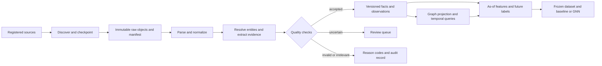

# PowerLaw data ingestion and forecasting design

Status: proposed design for review. No ingestion, migration, cloud purchase, or model training has been started.

Companion: [researched technical architecture, exact schemas, GNN tensors and connection checklist](2026-10-18-technical-architecture.md). The user has confirmed Germany first and both geographic/supply relationships and PyTorch Geometric support. The companion makes the general contracts below concrete and is required reading before implementation.

User constraint: **all tracked data sources must be free**. The [free-source register and mature-ingestion gates](2026-10-18-free-sources-and-ingestion-readiness.md) narrow the proposals below; purchased feeds, paid data subscriptions and commercial benchmark dependencies are excluded. Storage/hosting/optional model-processing costs are separate and remain disabled unless configured.

## 1. Goal and first useful result

The user's goal is construction prices and the wider purpose of PowerLaw. Build a system that explains and anticipates changes in construction costs, material availability, supply disruption, and regulatory obligations, with a traceable path back to evidence. Prices are the first measurable forecasting outcome; supply and regulation explain exposure and provide additional risk indicators.

The first useful result is a dated construction outlook: the latest measured construction/material prices; a forecast for the next reporting period with a calibrated interval when enough data exists, or an explicit uncertainty/data limitation; relevant changes in energy, demand, supply, and legislation; and links to the evidence. Distinguish observed changes, reported claims, forecasts, and hypothetical scenarios. A graph relationship or GNN prediction does not establish economic causation.

Confirmed scope and proposed implementation choices:

- Start with EU legislation and Germany as the first construction market (user-confirmed). Include geographic relationships and PyTorch Geometric support (user-confirmed). Expand geography only after the first end-to-end workflow passes its checks.
- Start with steel, cement/concrete, and their energy exposure; retain relevant demand, labour, transport, and financing context. Add timber and insulation after the pilot.
- Use 2010 onward for bounded official statistical history where available, plus current releases. Historical news coverage is a separate acquisition problem; RSS cannot supply this history.
- Primary forecast: next-quarter percentage change in Germany's new residential construction **producer price** index, conditional on confirming that exact series in source metadata. This is a sector benchmark, not a building-specific quotation or a house-sale price.
- Acquire monthly material producer prices alongside it. Cost indices and material PPIs remain separately named measurements; they never silently replace the primary construction producer-price target. If its coverage is inadequate, report that blocker and use a named material-price experiment while acquiring the proper construction series.
- Secondary outputs initially describe measured or reported supply disruptions and forthcoming legal obligations. Do not invent shortage/delay labels or promise predictions without outcome data.

Success means trustworthy, reproducible data and an honest benchmark. A GNN that fails to beat a simple baseline stays experimental.

## 2. What exists and what needs attention

Evidence is from source inspection on 2026-10-18, not a runtime audit.

| Existing part | Evidence and implication |
|---|---|
| Law collection | `src/scrapers/eurlex.py`, `eurlex_bulk.py`, `eurlex_history.py` download CELEX PDFs/metadata. Reuse discovery and download logic, but replace guessed legal status with authoritative metadata and include amendments/repeals needed for historical reconstruction. |
| Law extraction | `src/main.py` extracts text/tables, drafts rules, reviews JSON, embeds and writes `structured_rules`. It has two `process_pdf` definitions; Python uses the later one. Both ingestion methods delete existing law rows before replacement rows finish building. Stage and validate before publication. |
| Verification of rules | `src/prompts/rule_validation.py` fabricates `1900-01-01` for missing dates. Pro review receives draft JSON without evidence. `Mechanism.value` is required numeric even though prompts allow unknown/null. These contracts need correction before scaling. |
| News | `src/scrapers/news_scraper.py` reads RSS summaries, truncates them, uses optional LLM extraction, and otherwise uses heuristics. Missing dates become today; Python `hash()` supplies process-dependent IDs. Extraction can create fallback actions/reactions; graph ingestion links every action to every reaction. These are candidate interpretations, not verified facts. |
| Demo contamination | News with no fetched articles becomes benchmark seeds. Market data failure generates synthetic prices. Dashboard reads can seed graph/rule tables. Macro fallback values also exist. Separate explicit demo/test data from production and make unavailable data visible. |
| Two graph stores | `src/storage/graph_store.py` is used by the dashboard, scrapers, exporter, and trainer. It appends edges/history in memory and overwrites LanceDB tables plus Parquet files on save. `dual_layer_store.py` has typed LanceDB schemas, edge/node upserts, and temporal queries, but a different API/schema. It also loads whole tables into memory. Neither is sufficient unchanged at scale. |
| Split locations | Default law/news paths include `storage/lancedb`; graph/dashboard defaults include `data/lancedb`. Both directories exist. Inspection found `news_items` only under `storage/lancedb`, and graph tables under `data/lancedb`; both have `structured_rules`. Reconcile before choosing the authoritative dataset. |
| Temporal model | Current records have an effective timestamp, but no complete public-availability/ingestion/revision distinction. Existing as-of queries cannot establish what was knowable historically. |
| GNN | `src/gnn/trainer.py::prepare_dataset` uses all stored edges at every date, includes the final input metric as its regression target, and derives risk classes from metric magnitude across heterogeneous nodes. This is a demonstration, not validated construction-price forecasting. |
| Features | `graph_exporter.py` can mix metric names/units in node aggregates, calculate centrality from unfiltered edges, truncate/pad embeddings, and default to hash features. Correct these boundaries before comparing model accuracy. |
| Current footprint | `data/` and `storage/` contain 158 files, 8,646,133 bytes total (about 8.6 MB decimal), including seven law PDFs and a 12-record news JSON cache. Remote MinIO contents, other PC usage, and table row counts were not inspected. |

Reuse LanceDB, PyArrow/Parquet, the MinIO client, Pydantic, requests, existing extraction code, and the dashboard. Do not add Neo4j, a second vector database, Kafka, Kubernetes, or a workflow framework for this pilot. Never deserialize imported metadata with `eval()`; the legacy graph loader currently does so.

For the experimental typed GNN, add PyTorch Geometric rather than rebuilding its heterogeneous edge-message operators. Replace the deprecated Google SDK through the existing API wrapper before new paid extraction; the technical architecture documents the official SDK status and connection requirements. These dependency changes belong to implementation, not this planning pass.

### How to fix the current problems

These are proposed code changes, not completed fixes. The task numbers refer to the [implementation plan](../plans/2026-10-18-data-ingestion.md). Fix data-loss and truthfulness problems before the real-data pilot; complete forecasting fixes before interpreting model results.

| ID / timing | Problem and files | Concrete fix | Proof that the fix works / task |
|---|---|---|---|
| F01: before pilot | Conflicting DB paths: `src/main.py`, news scraper, graph stores, dashboard helpers | Add one `get_settings()` path policy. Every entry point uses the same configured production DB; demo/test paths are separate. Audit both existing locations, reconcile records by stable identity/version into a new directory, and switch configuration after reconciliation. Keep original directories for rollback. | Set one temporary DB path and import through each entry point; all records must be visible from the dashboard and graph. Compare migrated keys/history with both originals and test rollback. Tasks 1, 3. |
| F02: before pilot | Silent synthetic/seed fallback: news/market scrapers, `macro_fred.py`, `dashboard_data.py` | Require explicit demo mode for seeds/synthetic prices. In production, a failed source produces an unavailable/error status with retry metadata. Reads never initialize data. Existing uncertain records are quarantined until their origin is established. | Mock network failures and an empty production store: zero invented observations/events, zero automatic seed writes, visible source errors. Existing demo fixtures still work when explicitly selected. Task 1. |
| F03: before pilot | Unstable IDs and duplicate writes: news scraper, graph store, history records | Replace Python `hash()` and random ingestion identities with SHA-256 over canonical natural keys. Use separate document/event/version IDs; include series dimensions/period/vintage in observation identity. Upsert derived views by key and make accepted source versions idempotent. | Ingest the same release twice, including in separate Python processes: identical IDs/counts. Corrected content adds one revision; it does not overwrite evidence or create another unrelated event. Tasks 2, 3, 6. |
| F04: before pilot | Fabricated dates and lost time precision: news `_parse_date`, rule validators and temporal schemas | Return a nullable parsed date/time plus precision, timezone and parse status. Remove today/1900/1970 defaults. Retain original date strings; normalize genuine instants to UTC. Unknown availability blocks temporal training but may still allow document search/review. | Missing/malformed dates stay unknown; valid offsets normalize correctly; a date-only value is not promoted to an exact publication instant without a recorded policy. Tasks 2, 5, 6. |
| F05: before pilot | Destructive law replacement: `src/main.py::ingest_rules` and `ingest_law_full_text` | Remove delete-before-build behavior. Extract, validate, embed and stage a complete new document/rule version first. Publish through a committed batch; preserve the previous accepted version and select the new version only when complete. | Inject extraction, embedding and write failures: previous accepted rules remain visible. Successful replacement changes the current projection while old as-of queries still return the original rules. Tasks 3, 5. |
| F06: before pilot | Duplicate `process_pdf`, incomplete legal text and unsupported QA: `src/main.py`, rule prompts/schemas | Keep one `process_pdf` adapter and one shared document pipeline. Prefer structured text; process all provisions with definitions/annex context and record coverage. Supply cited source spans to the reviewer. Make non-numeric mechanism values nullable, preserve exceptions/conditions, and review unsupported dates/thresholds instead of inventing them. | Fixtures cover a long law, annex table, scan, exception and non-numeric obligation. Every accepted rule has matching evidence; incomplete parsing cannot publish a supposedly complete rule set. Tasks 2, 5. |
| F07: before pilot | Guessed current legal status and incomplete discovery: `src/scrapers/eurlex*.py` | Use authoritative legal identifiers, relations and dates from source metadata. Discover required amendments/repeals/decisions as dependencies; derive status for the requested date rather than using today's status everywhere. Preserve entry into force, application and national implementation as different concepts. | A repealed law remains present before repeal; an amendment changes only affected provisions from its application date; a required decision is not lost by an R/L-only filter. Task 5. |
| F08: before pilot | Fabricated news actions/reactions and all-to-all causal edges: news scraper extraction and graph ingestion | Return no event when the text supports none. Retain action/reaction evidence and status separately. Join only explicitly supported pairs; use `ABOUT` for factual relevance. Remove fallback first-sector matches and hardcoded confidence. Keep unknown magnitudes null and preserve genuine zero. | Negated/planned actions, unrelated reactions, no-event text and ambiguous entities produce the expected empty/review/factual results. No unsupported causal edge or default magnitude is created. Task 6. |
| F09: before pilot | Unsafe metadata parsing: `src/storage/graph_store.py::load` | Write metadata as JSON and parse with `json.loads()`. For trusted legacy Python-literal strings only, use a bounded `ast.literal_eval()` migration path, validate the result is a supported mapping, then rewrite as JSON. Invalid imported metadata is quarantined with its raw value; never evaluate code. | A malicious expression is rejected without execution; ordinary legacy dictionaries and JSON round-trip correctly. Task 3. |
| F10: before pilot | Two persistence implementations, append duplicates and whole-table rewrites: both storage modules | Make `DualLayerStore` the durable owner and keep `graph_store.py` as a compatibility adapter. Append immutable facts/observations, upsert rebuildable current views, and preserve multiple typed relations between the same endpoints. Filter/project in the backend; stop treating complete in-memory caches and repeated Parquet copies as independent authorities. | Legacy callers retain their return shapes, repeat imports do not inflate counts, parallel relations survive, and a narrow date/series query does not load all observations. Task 3. |
| F11: before pilot | Partial commits, lost cursors and unsafe retries: ingestion entry points | Add the single-writer SQLite ledger and immutable batch manifests. Archive evidence first, stage writes, validate references, then publish one commit marker. Readers ignore staged batches. Persist discover/fetch/extraction status separately; retry/resume the same identities. | Inject crashes before/after each durable boundary; restart converges to one complete visible batch and no source item is skipped. A second writer cannot acquire the same active job. Tasks 3, 4, 8. |
| F12: before forecasting | No public-availability/revision history: temporal schemas, stores and exporters | Add `available_at`, `recorded_at`, reference/event time, validity intervals, vintage and supersession links as typed fields. Select the latest eligible version per complete metric/series key using the chosen public/system as-of mode. Newly fetched revised history without vintage evidence stays retrospective-only. | A March value released in May is absent in April; June's revision cannot alter May's snapshot. Multiple metrics on one node remain separate. Tasks 2, 3, 7, 10. |
| F13: before forecasting | Future topology leaks into earlier snapshots: `trainer.py`, `graph_exporter.py`, `gnn_dataset.py` | Have all three use one as-of projection before building adjacency, centrality, text or features. Apply availability and validity filters to nodes, relation versions and descriptions; mask unknown nodes in a stable index map. Remove unconditional feedback edges from the factual training projection. | Adding a future edge/node or changing a later description leaves every earlier active feature and edge unchanged. Tasks 3, 10. |
| F14: before forecasting | Current-input regression target and invalid mixed-node risk labels: `trainer.py::prepare_dataset` | Remove the final-input metric as the forecasting target and the cross-node metric-magnitude risk classes. Build the explicit construction series Q-to-Q+1 growth label from the specified future release/vintage, with label masks and chronological splits. Keep supply/delay classification unavailable until measured outcomes exist. | Assert the label's future period is outside all input windows, unpublished labels are masked, and altering the future target changes labels only. Compare held-out results against seasonal/no-change baselines. Task 10. |
| F15: before forecasting | Mixed metrics/units and stale values: exporter, statistics normalization | Group by full series/metric/unit/base/adjustment identity. Convert only compatible units with preserved lineage; fit transforms on training data. Add missingness/release-age flags and per-series freshness rules; do not average unlike measurements or manufacture monthly observations from quarterly releases. | Separate EUR/t, index levels and output volumes in fixtures; known conversions agree; a quarterly release adds one observation; future changes cannot affect fitted historical transforms. Tasks 2, 7, 10. |
| F16: before semantic features | Incompatible vectors padded/truncated or treated as semantic embeddings: news persistence and exporter | Store model/version/dimension with every embedding. Use one verified vector space for each semantic feature set and reject mismatches. Name deterministic hash features as a separate baseline; cache vectors by content plus model version rather than only node identity. | An incompatible dimension/model is rejected; new text creates a new embedding version; hash features never silently replace unavailable semantic vectors. Task 10. |
| F17: before large graph training | Dense adjacency and expensive repeated graph metrics: `temporal_gnn.py`, trainer/exporter | Use typed sparse edge indices and edge-aware message passing, preserving direction. Use explicit per-type residuals rather than invalid self-loops across different node types. Keep price direction in an explicit feature, not a negative adjacency weight. Bound event windows; exact global centrality is optional and snapshot-specific. | Sparse edge messages agree with a tiny dense reference of the same operation; storage grows with edges, not node-count squared. The new attention model need not numerically match the legacy GCN. Task 10. |
| F18: before bulk ingestion | Disk growth, redundant copies and unverified remote uploads: MinIO client and store exports | Configure a private remote bucket; stream and checksum raw objects; make files evictable only after verified remote persistence. Enforce cache/temp/free-disk limits, compact analytical partitions, preserve referenced evidence and test an isolated restore before removing any sole original copy. | Simulated full disk, network interruption and checksum mismatch pause safely without losing evidence. Restored hashes/counts match the manifest. Tasks 4, 9. |
| F19: before paid extraction | No durable spending limit: extraction API calls and runner | Require a configured run-wide USD limit and verified model prices, reserve worst-case request cost before dispatch, and persist reservations/spend across retries and resumes. No configured budget or unknown usage means no new paid calls. Report persistent storage costs separately. | Unset/exhausted budgets dispatch zero paid calls; retry/resume cannot reset spend or exceed reserved limits. Task 4. |
| F20: before relying on the dashboard | Demo-dependent reads/tests and unsupported forecast confidence: dashboard helpers/pages/tests | Make reads consume committed production views without side effects; move seeds into explicit temporary demo fixtures. Display observed/reported/forecast/scenario status, price definition, source gaps and provenance. Use held-out residual calibration for intervals only when its minimum sample requirement is met. | Empty/stale/uncalibrated fixtures render honest unavailable states; rendering never imports/seeds/trains. A forecast panel shows its origin, target period, model version and calibration status. Tasks 1, 8, 10, 11. |

Implementation order: first fix configuration/origin isolation and pure contracts, then persistence and recovery, then source-specific extraction. Validate the real-data pilot before fixing/expanding forecasting. Large-scale graph optimization is only needed when the bounded workflow is trustworthy. For every fix, add the failing regression case first, make the smallest shared change, and rerun the affected callers' checks before moving on.

## 3. Sources and acquisition order

Every source needs a registry entry before production ingestion: source ID, owner/domain, discovery endpoint, allowed content/use, attribution, authentication, historical coverage, language, geography, cadence, pagination, incremental cursor, rate/size limits, expected schema, and freshness policy. Record the date terms and endpoint behavior were checked. A documentation link is not an endpoint smoke test.

Require `access_fee=0` and `requires_paid_subscription=false`, plus confirmed allowed uses for the selected records. Free registration is acceptable; paid trials and automatic paid fallbacks are not. Use the companion register's source IDs, onboarding requirements and polling policies. If no suitable free ground truth exists, report a coverage gap instead of adding a paid source or inventing data.

| Priority | Source and acquisition | What to keep; what it contributes |
|---|---|---|
| 1 | EUR-Lex/CELLAR metadata discovery via SPARQL; retrieve structured HTML/XML where available, PDF fallback | CELEX/ELI/CELLAR IDs, language, exact version, article/paragraph/annex anchors, scope and legal timeline. Begin with existing relevant laws and their amendment dependencies: building performance, construction products, carbon/energy, relevant trade restrictions. Verify seed IDs/titles rather than trusting hardcoded mappings. [Official extraction guide](https://eur-lex.europa.eu/content/tools/webservices/DataExtractionUsingWebServices.pdf). |
| 1 | Eurostat Statistics/SDMX APIs, bounded series selections | Discover `sts_copi_q` for construction cost/producer-price indicators and confirm the producer-price meaning and DE availability; acquire `sts_inppd_m` for available C23/C24 material PPIs, `sts_copr_m` construction production, and `sts_cobp_m` permits. Read dimension dictionaries and coverage before locking full series keys. Keep base year, adjustment, flags and measurement definition. [API documentation](https://ec.europa.eu/eurostat/en/web/user-guides/data-browser/api-data-access/api-introduction), [domestic producer prices](https://ec.europa.eu/eurostat/databrowser/view/STS_INPPD_M__custom_9196862/default/table?lang=en), [permits](https://ec.europa.eu/eurostat/web/products-datasets/-/sts_cobp_m). |
| 1 | ECB SDMX API | EUR exchange rates and relevant financing/rate series, with complete keys and definitions. Use date bounds and `updatedAfter` for revisions. [ECB API](https://data.ecb.europa.eu/help/api/data). |
| 1 | Bundesbank public SDMX and SMARD official downloads | German financing/credit context and German electricity generation/load/wholesale-price context. Source-check selected Bundesbank series' reuse rights; SMARD market downloads are free under CC BY 4.0 with attribution. Avoid counting overlapping ECB/Bundesbank or SMARD/ENTSO-E observations as independent evidence. [Bundesbank API](https://www.bundesbank.de/en/statistics/time-series-databases/help-for-sdmx-web-service/web-service-interface-data), [SMARD terms](https://www.smard.de/home/datennutzung). |
| 1 | Geographic identity/hierarchy; Eurostat GISCO where geometry is needed | Create Germany/EU/partner coverage nodes and versioned geographic links. Preserve ISO/NUTS edition, role, validity and source precision; use boundaries/coordinates only at a resolution supported by the data. The technical architecture defines relations, CRS and optional trade enrichment. [GISCO NUTS](https://ec.europa.eu/eurostat/web/gisco/geodata/statistical-units/territorial-units-statistics). |
| 1 | Existing official Commission feeds, verified individually, plus selected issuer/regulator feeds | News about actual capacity changes, outages, energy/trade changes, and legal announcements. Attribute the original publisher and underlying release. Retain permitted text and evidence spans, not just an aggregator snippet. Existing feed URLs are candidates pending smoke tests. |
| 1 | Destatis GENESIS public statistics | Direct German construction-price target and available material/labour/cost breakdown. Discover family 61261 and candidate quarterly table 61261-0002; lock actual dimensions/definition at onboarding. API access is free, with free registration where required; use current REST/JSON POST methods. Do not silently substitute consumer inflation, input cost or house prices. [Free API](https://www.destatis.de/DE/Service/OpenData/genesis-api-webservice-oberflaeche.html), [current interface changes](https://genesis.destatis.de/datenbank/online/announcement). |
| 2 | Eurostat COMEXT/PRODCOM | Narrow CN/CPA product and partner selections for steel/cement import/export quantities, values and output. Keep classification versions and conversion definitions. Trade unit values are composition-sensitive proxies, not transaction spot prices. |
| 2 | ENTSO-E Transparency Platform | Selected bidding-zone electricity prices and outage/load data, daily aggregation from retained source intervals. Requires API access/token onboarding; no need to ingest the whole electricity system. [Official access guidance](https://transparency.entsoe.eu/content/static_content/download?path=%2FStatic+content%2FAPI-Token-Management.pdf). |
| 2 | Free official/individually approved feeds and GDELT discovery | Filter by materials, geography, companies and disruptions. GDELT supports bounded discovery; publisher article access/reuse and event accuracy remain separate. No paid publisher subscription, paywall retrieval or global archive download. [GDELT documentation](https://gdeltproject.org/data.html). |
| 3 | Public-origin FRED/ALFRED series only | Optional global context after per-series fee/reuse checks. Historical features use available vintages. Restricted third-party series are excluded; Yahoo/yfinance is not a tracked dependency in this free-source plan. [Vintage semantics](https://fred.stlouisfed.org/docs/api/fred/realtime_period.html). |
| Later, only if freely provided | User-owned supplier quotes, actual delivery records and permitted open tenders | Potential local procurement/delay ground truth without a purchased feed. Define product, delivery location, tax/freight inclusion and permissions. Unavailable free lead-time/spot-price data remain gaps; no proprietary benchmark purchase is part of the plan. |

For each source, ingest a saved fixture and a small live sample before enabling its schedule. Store unavailable/blocked as source status; do not fall back to invented data. Public availability does not grant uniform rights: record retention, extraction/model-use and redistribution permissions separately. EUR-Lex itself distinguishes metadata, legal documents, editorial/consolidated texts, and exceptions. Replace the README's blanket reuse/TDM claim with source-specific references to the [official legal notice](https://eur-lex.europa.eu/content/legal-notice/legal-notice.html?locale=en).

## 4. Workflow and recoverability

1. Discover IDs/URLs/series updates; persist source cursor and request parameters. Revisit an overlapping window to catch late arrivals and revisions. Keep periodic full reconciliation for sources whose change feeds omit deletions.
2. Fetch with timeouts, bounded retries for transient failures/429s, `Retry-After`, conditional ETag/Last-Modified requests where supported, and per-source rate limits. Limit redirects, downloaded bytes, response types, and PDF/page sizes. Only approved public HTTP(S) hosts; reject redirects to local/private addresses. Never log credentials or URL tokens.
3. Archive source bytes under content-addressed keys, e.g. `raw/eurlex/32023R0956/en/<sha256>.xml` and `raw/news/2026/10/18/<sha256>.json.gz`. Preserve requested/final URLs, HTTP metadata, checksums and fetch times. Unsupported retention means metadata-only mode, explicitly ineligible for unsupported extraction.
4. Parse safely; preserve original text, offsets/pages/table coordinates and extracted text separately. Structured legal text is preferred to OCR. Detect scans/garbled text; OCR only affected documents/pages, or queue them for review. Record parser/version and coverage; never silently drop a long document after 150,000 characters.
5. Apply cheap relevance filters before paid extraction; low relevance means out-of-scope, not factually false. Extract only evidence-backed statements, including negation, planned/conditional events, actors, units, quantities, geography and occurrence time. Treat fetched text as data, never as tool instructions.
6. Resolve canonical entities and classify evidence. Validate structured candidates deterministically; targeted LLM review sees source spans and needed surrounding clauses. Save all extraction attempts, not only the final answer.
7. Publish an accepted batch only after raw storage, validation, and reference checks succeed. Use immutable batch IDs and a durable committed-batch manifest; graph/features read committed batches only. LanceDB updates across several tables are not assumed to be one transaction. Recovery resumes staged writes and commits once; a failure cannot expose half a batch.
8. Rebuild graph/features from accepted facts. Advance source cursors only after durable recording of the source work. A document can be fetched successfully but require extraction review; these are separate statuses.

A small local SQLite job ledger from the standard library is sufficient for cursors, attempts, leases and batch status, with one writer process. Persist/checkpoint it alongside immutable manifests for recovery. Do not run the same embedded ledger from two machines. If ingestion moves to a server, move the single writer and ledger together.

## 5. Data contracts and timestamps

Keep frequently filtered fields typed, rather than hiding them in JSON. Use JSON for parser-specific extras, evidence lists and structured legal expressions. UTC instants use timezone-aware microsecond timestamps; reference dates/periods remain dates/periods. Unknown is null with a reason, never zero, today, 1900, 1970, or a guessed all-time validity interval.

| Record | Required content |
|---|---|
| `source_documents` | `document_id`, `version_id`, `source_id`, upstream ID, canonical and final URL, title, publisher, original language, content type, `content_sha256`, raw/text URI, bytes, publication/update/fetch times, date precision, coverage/parser status, rights/attribution, run/batch ID, schema/parser versions, `data_origin` (`live`, `demo`, `test`). |
| `entities` | Stable canonical ID, type, canonical label, aliases, external identifiers, jurisdiction/geography, classification system/version, matching evidence and review state. Map CELEX/ELI, NACE, CN/CPA, series keys, and company LEIs/ISINs when available. Keep unresolved names without forcing a match. |
| `facts` | Append-only `fact_id` and `fact_version_id`, subject, predicate, object or typed payload, supporting document version(s)/span(s), event kind/status, valid interval, public-availability and recorded times, confidence components, review decision/reason, supersedes/retraction link, extraction model/prompt/version, batch ID. Relations and legal rules live here before graph projection. |
| `observations` | `observation_id`, `revision_id`, entity/series ID, metric, value (nullable), unit, currency, period start/end, frequency, geography, product specification, base year/adjustment, publication/availability/ingestion times, vintage, provider flags, missingness/reason, source-document version, conversion lineage and committed batch. Both node and edge measurements can reference a subject ID/type. |
| `quality_reviews` | Candidate/version ID, check version, decision, machine reason codes, reviewer/override reason/time; model confidence is not the review decision. |
| `dataset_manifests` | Dataset ID, frozen input batch/manifest hashes, temporal mode, cutoff rules, graph/feature/label versions, embedding model/dimension, entity vocabulary, windows, splits, transforms, source exclusions, data hashes and training configuration. |

`nodes`, `edges`, and existing tabular views are projections for graph traversal and dashboard compatibility; the versioned facts/observations are authoritative. Keep `structured_rules` and `news_items` as searchable, rebuildable document/extraction views during migration.

Distinguish these times:

- `event_at` or `reference_period`: when the reported event occurred, or what period an observation measures.
- `published_at` / `source_updated_at`: what the publisher declares, with precision/timezone and evidence. Missing publication time stays unknown.
- `available_at`: earliest **verified public availability of this exact version**, with `availability_basis` such as archived release, provider vintage, or first fetch. For newly fetched history without vintage evidence, use first fetch conservatively; never backdate today's revised data.
- `fetched_at`, `recorded_at`: when this installation acquired and committed it.
- `valid_from`, `valid_to`: when a rule, relation, or state applies; half-open intervals `[from, to)`, null end for open-ended validity.
- `supersedes_version_id` / retraction: which prior assertion is corrected. Preserve old versions and their historical visibility.

Two explicit query modes: `public_as_of` reconstructs the version publicly available by cutoff; `system_as_of` additionally requires the installed system to have committed it by cutoff. Choose the most recent eligible revision **per complete observation key**, not per node. Effective intervals also filter graph relationships. An announced future obligation is a known upcoming event feature, not an active obligation before its application date.

Eurostat warns that its API contains the latest dataset, without past versions. Archive each retrieved version now; historical revised values without release evidence belong to a separately labelled retrospective dataset and cannot substantiate leakage-free historical evaluation. ECB deltas help capture new revisions; ALFRED provides explicit historical vintages for covered series. [Eurostat version limitation](https://ec.europa.eu/eurostat/en/web/user-guides/data-browser/api-data-access/api-introduction), [ECB revisions](https://data.ecb.europa.eu/help/api/data), [ALFRED](https://fred.stlouisfed.org/docs/api/fred/series_observations.html).

### Stable identity, duplicates and units

- Use full SHA-256 identity keys and natural keys, never Python `hash()` or short random IDs. `document_id` tracks a source identity; `version_id` incorporates content hash. Remove tracking URL parameters without deleting parameters identifying a real article. Preserve upstream GUIDs and original URLs.
- Exact byte/text hashes avoid duplicate extraction. Near duplicates cluster syndicated articles but retain all publishers and differing claims. Separate `article_id` from `event_cluster_id`; merged events retain provenance, and cluster changes are versioned so future corroboration does not alter old snapshots.
- Observation natural key includes provider/series, all dimensions, reference period, unit and adjustment; revisions add a provider vintage or first-observed version. Re-importing the same release is a no-op.
- Separate original and normalized value/unit. Distinguish percent, percentage points, fractions, index levels/base year, tonnes, kg, MWh, nominal EUR, real EUR and currency conversions. Keep conversion rule and exchange-rate vintage. No averaging of price, output and emissions into one node metric.
- Version NACE/CN/CPA mappings. Dataset-specific classifications matter: Eurostat says STS continues NACE Rev.2 through 2027 and switches in 2028. Do not globally remap all 2025 data. [STS classification schedule](https://ec.europa.eu/eurostat/web/short-term-business-statistics/legislation).

## 6. What goes in the graph

The graph answers who/what is related and under what evidence and time interval. The temporal tables hold measurements, revisions and states. Full articles, PDFs, images and every market tick stay outside the traversal graph.

| Node type | Meaning and identity |
|---|---|
| `LAW` | A CELEX legal work, linked to versioned provisions; the visible description/status is selected as of cutoff. |
| `ACTION` subtype `LEGAL_RULE` | One independently applicable obligation, threshold, exemption, prohibition or reporting requirement at article/paragraph/annex level. Existing action type is reused; do not create one node for every sentence. |
| `ACTION` subtype `ECONOMIC_EVENT` | A sourced capacity cut, closure, investment, restriction, outage or similar event. Planned, alleged, confirmed, cancelled and conditional are separate statuses. |
| `REACTION` | A separately evidenced reported or measured outcome. Reported magnitude remains a claim; numerical ground truth comes from observations. It is optional, never fabricated to complete a chain. |
| `SECTOR` | NACE code plus version and geographic scope, including construction subsectors. |
| `COMMODITY` | Physical product/grade/market, e.g. cement or steel grade; keep electricity zone, natural gas benchmark and carbon allowance distinct. |
| `ECONOMIC_INDEX` | A fully specified statistical/market series: provider, dimensions, region, metric, unit, frequency, base year. Construction cost, producer price and house-price indices are different nodes. |
| `COMPANY` (new actor type) | Canonical organization owning/operating capacity or acting in an event; ticker is an identifier of a security, not the company or commodity itself. |
| `GEOGRAPHY` (confirmed geographic scope) | Country, jurisdiction, NUTS region or market/bidding zone with classification version, hierarchy and evidenced coverage. Region identity does not invent plant coordinates or local price labels. |

Start with factual relations: `LAW -> MANDATES -> LEGAL_RULE`, `LEGAL_RULE -> REGULATES -> SECTOR/COMMODITY`, `LAW -> AMENDS -> LAW`, `COMPANY -> PERFORMS -> ACTION`, `COMPANY -> BELONGS_TO -> SECTOR`, and noncausal `ACTION/REACTION/INDEX -> ABOUT -> SECTOR/COMMODITY/COMPANY`. Add `PERFORMS`, `BELONGS_TO`, `ABOUT` and the technical architecture's geographic/history relations (`LOCATED_IN`, `WITHIN`, `MEASURES`, `FLOWS_TO`, `APPLIES_IN`) to both schema vocabularies/compatibility paths. Conditional legal scope remains in the rule payload, not an unconditional broad edge.

`TRIGGERS`, `CAUSES`, `IMPACTS`, and `AFFECTS_COST_OF` require explicit support and `claim_kind` (`source_claim`, `measured_association`, `expert_hypothesis`). A co-mentioned action/reaction is not automatically a causal pair. Hypothesis edges can be explored in a separate graph view but are excluded from the initial training projection. External research parameters retain population, method, units and uncertainty; do not treat them as universal elasticities.

Every edge needs deterministic identity, typed endpoints/relation, evidence IDs, assertion version, direction, valid interval, availability time, review state, and source kind. Keep confidence, measured magnitude/sign, and model message-passing weight separate. No arbitrary weights such as 1.4 presented as empirical exposure; no negative adjacency to encode a falling price. Missing timestamps or unresolved endpoints prevent training eligibility.

### Law-specific extraction

Preserve adoption, publication, entry into force, application, transitional deadlines, transposition and repeal as separate dates. Directives do not prove uniform national implementation. Keep EU requirements distinct from national implementing measures; flag that national-law coverage is incomplete in the initial pilot.

Rules need exact article/paragraph/table evidence, addressee/role, jurisdiction, material/product code scope, conjunction/disjunction of conditions, exceptions, operator, threshold/unit, temporal phases, and amendment dependencies. Non-numeric obligations have no made-up numeric mechanism value. Recitals are context, not binding obligations. A published future phase can inform an upcoming-deadline feature before it applies. Derive status at a requested time; today's repeal status must not erase a law from past graphs.

For example, a sourced carbon-reporting obligation becomes `LAW -> MANDATES -> ACTION(LEGAL_RULE) -> REGULATES -> material sector`. Its threshold, covered products, reporting phase and effective dates stay in the rule/facts tables. Actual energy/material price observations are separate series linked by `ABOUT`; no claim that the law mechanically caused a chosen price increase.

## 7. Good data, bad data and uncertain data

Use four decisions: accepted, needs review, rejected, and out of scope. Keep reason codes. Duplicates link to a retained record rather than disappearing; source outages are operational failures rather than rejected data.

| Check | Rule |
|---|---|
| Source/evidence | Approved source/use, recoverable allowed evidence, identity and lineage required. A 200 response containing a login/error page is not a successful document fetch. |
| Parsing | Validate schema, complete required sections, content/hash, language, encoding and parser coverage. Truncation, OCR uncertainty or unsupported tables go to review. |
| Dates | Preserve full times, original timezone and precision. Impossible dates are rejected; missing availability/date evidence blocks temporal training, even if searchable. A genuinely scheduled future law is valid data. |
| Numbers | Unit/dimension compatibility, finite values, valid denominators and series-specific ranges. A zero is valid only when evidenced. Unusual genuine price spikes go to review; do not delete all outliers or assume every price must be positive. |
| Entities | Exact identifier matches or reviewed aliases can enter topology. Ambiguous company, country, grade, sector or product mappings stay unresolved; do not use the first available sector as a substitute. |
| News semantics | Support action, actor, magnitude, event time and claimed relationship independently. Negated or planned events do not become completed events. An article with no extractable event remains an article. |
| Legal semantics | Check cited provision, role/scope, conditions, units, activation basis and exceptions against source. Missing thresholds/dates stay unknown. Critical unsupported obligations are reviewed. |
| Graph | Allowed endpoint pairs, no dangling references, version/interval consistency, committed provenance, deterministic IDs and no unsupported causal edge. |
| Temporal observations | Keep provider provisional/revised/confidential/missing flags, enforce key uniqueness by vintage, and select revisions as of cutoff. |

Measure extraction quality against a manually annotated set, not LLM self-confidence. Pilot review set: 30 representative legal provisions (including tables/exceptions/amendments), 100 relevant and irrelevant news items (including duplicates/negation/plans), and 20 statistical series with revision/missing-value cases. Review all initial legal rule outputs from the small pilot.

Proposed expansion gates: at least 95% precision for accepted news event/entity links on held-out review items, at least 95% accuracy for key legal fields with **zero unsupported critical obligations** in the pilot review, and at least 90% recall on relevant items in the fixed discovery fixture. Publish counts/uncertainty: a small sample is not a population guarantee. Every accepted assertion needs evidence; every training record needs verified availability or an explicit exclusion. Thresholds are initial operational choices, to be calibrated from the review set; model scores alone never satisfy them.

## 8. GNN inputs, labels and evaluation

Do not feed the entire archive to the GNN. Build a reproducible, task-specific projection around construction markets, relevant materials/energy, accepted events/rules, and explanatory series.

- Use quarterly forecast origins for the primary construction price target: the final UTC instant of reference quarter Q, predicting growth from Q to Q+1. Q's index may still be unpublished at origin; it is not assumed to be an available feature. Retain monthly/daily source resolution in storage and aggregate only releases/events available by that instant. Monthly material-price experiments have separate manifests and labels; do not manufacture monthly construction labels from a quarterly series.
- Features: per-series lagged changes and rolling volatility; construction activity/permits; labour and financing inputs when available; available supply/capacity and trade changes; event counts/severity with source diversity and duplicate controls; legal scope, status and time to known deadlines. Add missingness masks, age since release, provisional flags and coverage indicators.
- Keep release frequency and reference period. Forward-fill an actually available level only within its declared freshness policy and mark its age; do not forward-fill returns/events, backfill from the future, or count a quarterly value repeated daily as new information.
- Text is optional initially. Existing hash vectors can be explicitly named baseline features, not semantic truth. For semantic embeddings select one compatible 768-dimensional model/version and keep it separate from other vector spaces. Reject mismatches; no truncating/padding unrelated embeddings. Frozen text/model versions must not contain post-cutoff summaries. Retrospective text encoders need disclosure; strict historical claims require an encoder available at the evaluated time or a structured/text-free baseline.
- Fit scaling, imputation, vocabulary selection, dimensionality reduction and any learned graph only on training data. Persist them. Do not combine heterogeneous units in a single regression target or compute historical centrality from the final graph.
- Export float32 `x[N,F]`, int64 sparse `edge_index[2,E]`, relation IDs/attributes, stable node-index maps, active-node masks, feature/missingness masks, forecast origin, label masks and manifest. Use a stable universe within a training sequence and mask nodes not yet knowable; verify that adding future nodes cannot change old active features or edges. Bound transient event nodes to a 90-day lookback by availability, with upcoming accepted events represented separately; persistent closure/capacity effects require separately evidenced state facts rather than extending every article indefinitely.
- For the selected heterogeneous model, `x` and edge tensors are dictionaries per node/relation type in PyG `HeteroData`, not one mixed matrix. The technical architecture fixes eight quarterly snapshots, 12 edge-attribute channels (six values plus masks), type-local index maps, two 32-channel edge-aware graph layers, a masked per-node GRU and a target-series-only head. Computational reverse/context links carry lineage and never become unsupported causal facts.
- Primary label is `100 * (P_Q+1 / P_Q - 1)` for the specified producer-price series. The first-release growth label uses both levels from the **same earliest verified release/vintage containing Q+1 and a comparable Q denominator**, with identical base/adjustment/dimensions. It does not divide separately first-released index levels across incompatible vintages. Persist origin, both reference periods, vintage, label availability and policy; mask missing/incompatible labels. Final-vintage scores use their own frozen vintage and are reported separately.
- Concrete example: origin `2026-09-30T23:59:59.999999Z`, denominator period `2026-Q3`, numerator period `2026-Q4`. Features use only data available by that September origin, possibly Q2 construction prices plus monthly context. Once an authoritative release first publishes Q4 and a comparable Q3 level, that release fixes the first-release growth label and its availability date. Neither a later Q3 release nor Q4 can enter the September inputs. This is a next-quarter forecast, not a forecast made on Q3's later publication date.
- Supply/delay prediction is deferred until measured delivery, lead-time, capacity or shortage outcomes exist. For now report sourced events and coverage; narrative severity and current price magnitude are not future risk labels.
- Use expanding chronological train/validation/test windows, with a horizon gap/purge for overlapping targets and training only on labels available at each simulated training time. Deduplicate syndicated stories before splitting. Report MAE/RMSE and directional accuracy by target/period. For an initial 90% prediction interval, calibrate absolute residuals on a separate chronological calibration window of at least 20 eligible forecast origins; use the finite-sample 90% residual quantile around the point forecast. Evaluate held-out interval coverage and width, and disclose that distribution shifts can invalidate calibration. With fewer origins, show uncertainty as uncalibrated/unavailable rather than inventing a confidence band.
- Compare seasonal/no-change forecasts and a small tabular lag model before the GNN. Ablate news, legal features and topology. A few dozen quarters for one geography is a serious sample-size limit: keep a small baseline, acquire comparable market histories, or defer GNN training. More article nodes do not create more independent target observations.

Use the existing model only as an explicit demo until these conditions hold. Its dense adjacency is unsuitable for a large news graph: 50,000 nodes require about 10 GB for a single float32 adjacency, before activations or gradients. Start bounded and move actual message passing/normalization to sparse tensors before expansion. Keep graph degree features cheap; exact global betweenness on every refresh is unnecessary.

Scenario output is conditional: state the changed assumptions and uncertainty. Do not describe the existing shock simulator as a validated causal model of construction prices.

## 9. Storage when PC space is limited

Recommended starting architecture: private remote S3-compatible storage for raw evidence, compressed normalized partitions, manifests, backups and frozen datasets; a small local LanceDB working database and bounded cache; local CPU processing initially. Running MinIO on this same PC does not create more disk capacity.

| Option | Fit and published storage-only price checked 2026-10-18 |
|---|---|
| Cloudflare R2 Standard (recommended for pilot) | S3-compatible, 10 GB-month free storage, then $0.015/GB-month; direct egress is free, requests are separately priced. Roughly $1.35/month for a steady 100 GB after the free 10 GB, or $14.85 for 1,000 GB, before requests/tax/other services. [Pricing](https://developers.cloudflare.com/r2/pricing/), [service/API](https://developers.cloudflare.com/r2/how-r2-works/). |
| Backblaze B2 | S3-compatible; published starting rate $6.95/TB/month and free egress up to 3x stored volume. Suitable for a larger archive with controlled downloads; compare total retrieval and regional requirements. About $0.70 for 100 GB or $6.95 for 1 TB before allowances/tax/other services. [Pricing](https://www.backblaze.com/cloud-storage/pricing). |
| Existing remote MinIO | Reuse if it is actually on another machine with sufficient space, backup and reliable access. Endpoint/network/ownership/capacity have not been checked. |
| External SSD / remote host later | SSD is the simplest offline capacity option; a remote host adds always-on ingestion/compute but separate operational cost. Neither is needed for the current 8.6 MB pilot footprint. |

These are indicative USD arithmetic at published rates, not total running-cost quotes. Optional LLM extraction, requests, compute and backup copies may cost more than storage. Data-source subscriptions are excluded. No provider account or paid resource is created by this plan; deterministic ingestion/manual review remains usable without a paid LLM.

Paid extraction is disabled unless a positive run-wide `extraction_budget_usd` and current verified model prices are configured. A run ID covers all retries, resumes and source jobs belonging to that run; resuming cannot reset spend. Reserve worst-case input plus capped output-token cost before each request, reconcile actual usage afterward, and stop new calls if the reservation exceeds the remaining budget. Retries need their own reservation; unknown prices/usage fail closed. The operator chooses the amount before executing paid work; free deterministic collection can continue independently. Optional monthly storage/compute limits require a provider usage baseline plus projected growth checks; if absent, no new paid provisioning or bulk expansion is enabled. Existing stored objects may continue to incur charges after ingestion stops, so report that separately from an enforceable request budget.

Initial limits: 2 GiB local working cache plus a 512 MiB temporary-download budget, with a free-disk floor of max(2 GiB, largest expected batch staging estimate). Fail/pause before exhaustion. Keep authoritative local database/ledger separately budgeted; never evict those as cache. Adjust these defaults after inspecting actual free disk and available RAM.

- Stream downloads/uploads, checksum and verify remote persistence before making a file evictable. Delete only reproducible cache/temp files that are not in use. Keep independent backup and test restore before deleting any sole existing copy.
- Use `.jsonl.gz` for permitted raw/text batches and ZSTD Parquet for normalized analytical partitions. Partition by source/domain and month or year according to measured volume; avoid one Parquet file per article. Target compact 32-128 MiB files when volume warrants it, with immutable manifests.
- Store embeddings once per content/model/version. One million 768-dimensional float32 vectors alone take 3.072 GB decimal before index/metadata overhead. Avoid vector copies in every snapshot and embedding every raw paragraph automatically.
- Query/filter columns and time windows in the storage engine rather than loading all tables into Pandas/in-memory lists. Maintain one durable canonical dataset; make exports rebuildable snapshots rather than a second constantly rewritten full database.
- Extend the existing MinIO client/configuration for a configured private bucket and endpoint; managed providers may not permit creating the hardcoded `laws/news/papers` buckets. Do not rely on default development credentials. Verify S3 compatibility through upload/checksum/read/restore smoke tests.
- Do not turn a remote `s3://` URI into a local `Path`, or place a live embedded database in a OneDrive/Dropbox sync directory. Pilot keeps local LanceDB with remote immutable snapshots. Remote live database/querying is a separately benchmarked later step, not an assumption that the current store supports it.
- Retain evidence referenced by accepted facts/datasets as permitted, all manifests/reviews and essential backups. Rotate redundant cache, failed temporary files and derived datasets by policy. Rejected raw content gets a 30-day default retention only where allowed; keep hashes/reasons longer. Source-specific retention/deletion requirements override defaults and must propagate into derivatives.

## 10. Delivery sequence and stop conditions

| Phase | Deliverable | Gate before proceeding |
|---|---|---|
| A. Prepare | Read-only inventory, source/target registry, one path policy, demo separation, stable IDs, typed temporal/evidence contracts and reviewed fixtures | No silent synthetic production fallback; all source and target semantics explicit; existing datasets backed up with restore proof. |
| B. Make writes reliable | Canonical typed LanceDB store behind the existing API, append-only facts/observations, job ledger, committed batches, idempotent imports, reversible migration and bounded object cache | Re-import/restart adds no duplicates; an interrupted commit exposes no partial dataset; existing IDs/history survive migration. |
| C. Small real ingestion | Existing relevant laws plus amendment dependencies (initial cap 20 acts), up to 300 news documents from verified sources, and 20-40 bounded official series | Publish quality report and evidence links; review initial legal outputs; meet quality gates and record gaps. No claim that pilot volume is enough to train a GNN. |
| D. Continuous operation and history | Incremental scheduled collection, legal/series revision reconciliation, bounded statistical backfill, explicitly scoped historical news acquisition | Seven days of traceable runs; outage/revision/restore tests pass; storage and extraction costs stay within limits. |
| E. Forecast dataset | Release-aware feature/label build, frozen manifests, simple forecast baselines, experimental sparse GNN only if enough honest observations exist | Future-data perturbation cannot change old snapshots; held-out performance reported; no target copied into its inputs. |

The detailed implementation tasks are in `../plans/2026-10-18-data-ingestion.md`. Start with preparation and the pilot; unlock larger ingestion only after the relevant gates pass.

Initial schedule: official news discovery hourly, end-of-day event aggregation; legal metadata/revision checks daily with weekly dependency reconciliation; statistical release polling daily with bounded revision windows and monthly reconciliation. Use Windows Task Scheduler for one CLI worker; move that worker unchanged to a server if always-on collection becomes necessary. No Streamlit page should own a long-running ingestion job.

Track per-source discovered/fetched/parsed/accepted/review/rejected/duplicate counts, newest available period, last successful cursor, publication-to-fetch lag, evidence coverage, unit/date/entity error rates, pending review age, API/LLM cost, disk/cache bytes and committed batches. Alert/status on consecutive source failures or freshness breaches; zero news can mean either a quiet source or a failed parser, so inspect HTTP/parser health separately. UI shows source gaps and demo mode prominently.

## 11. Decisions and limitations

Germany first, geographic relationships, PyTorch Geometric and free data sources are user-confirmed. Remaining choices are the exact official construction measure, storage/optional extraction budget and permitted free news coverage. The source register identifies coverage gaps and account actions. The wider construction-risk goal remains represented even where free sources do not provide sufficient ground truth. Long-term storage keeps portable evidence/history and frozen training releases; a shared-service PostgreSQL migration is conditional on measured requirements, not immediate pilot work.

No live database row audit, MinIO access, endpoint/authentication smoke tests, model run, or extraction accuracy measurement was performed. `python` is not available on this shell's PATH, so existing tests were not run. Static findings and verified source documentation support the plan; they do not establish current live dataset quality or model accuracy.
