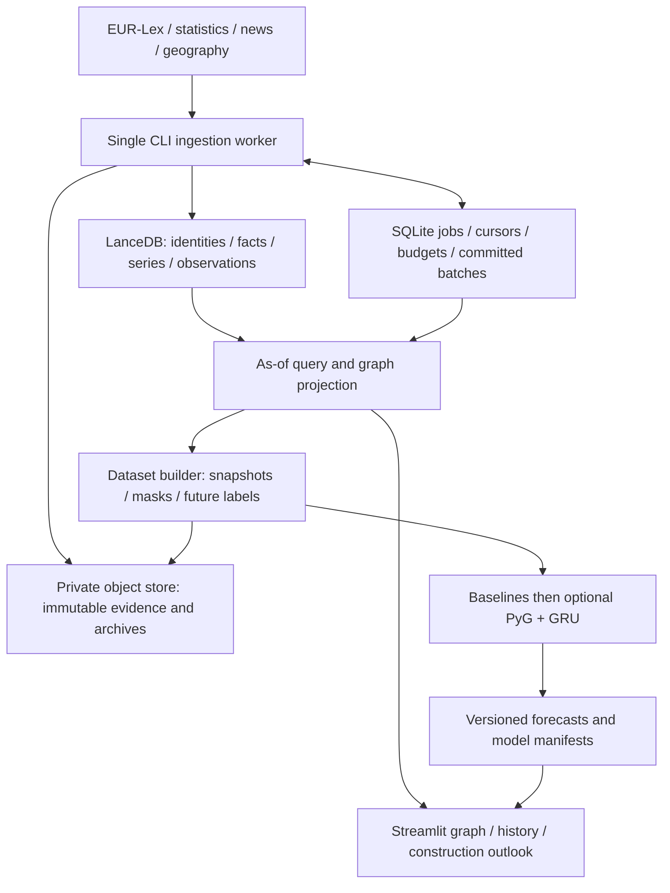

# PowerLaw technical architecture: graph, history, geography and temporal GNN

Status: researched proposal, 2026-10-18. Documentation only; services and connections have not been created or tested.

User-confirmed scope: **Germany first**, with both **geographic/supply relationships** and **PyTorch Geometric**. Construction prices are the first measurable target within the wider construction cost, supply and regulatory outlook.

Additional user constraint: **all tracked data sources must be free**. See the [free-source register, long-term storage recommendation and maturity gates](2026-10-18-free-sources-and-ingestion-readiness.md). This excludes purchased feed/data subscriptions; optional processing/hosting costs are separate and not enabled by this documentation.

This document makes the [ingestion design](2026-10-18-data-ingestion-design.md) and [implementation plan](../plans/2026-10-18-data-ingestion.md) more specific. Its named storage, schema, geographic and tensor contracts govern implementation where the earlier documents gave general alternatives. The existing quality, temporal-eligibility, migration and cost gates still apply.

## 1. The central idea: a graph connected to histories

Your proposed structure is appropriate: a graph node identifies something, relationships describe how it connects to other things, and linked tabular records describe its state over time. The graph can lead to several histories, not just a single latest number.

For example, a German cement market can link to a monthly producer-price series, a production series, relevant legal obligations, reported plant closures and its geography. Each measurement series has its own units, frequency and release history. Selecting the cement node follows stable IDs to those records; it does not open a newly created database for that node.

Use shared typed tables indexed by IDs. Do not create one database/table for every material, company, cause or timestamp. That would make cross-node queries, revisions and training unnecessarily difficult. An event is not automatically a cause: store the reported event and any claimed causal relation separately.

There are three different graphs:

1. **Evidence/knowledge graph:** accepted entities, obligations and supported relationships, with provenance and time validity. It supports explanation and inspection.
2. **Geographic/economic graph:** the subset describing locations, jurisdiction, measured trade/supply links and exposure. Geographic proximity alone does not establish a supply link.
3. **Training graph:** a bounded, as-of projection of the first two, with numeric features, typed message routes and masks. The neural network reads this tensor representation, not a live graph database or PDF archive.

## 2. What the research establishes, and the design choice

| Approach | Research finding | Fit for PowerLaw |
|---|---|---|
| Discrete spatiotemporal snapshots | DCRNN combines directed graph structure with temporal recurrence for traffic forecasting. Its spatial links represent a specific physical system. [Original paper](https://arxiv.org/abs/1707.01926). | Use the general graph-plus-time pattern, not its road-network assumptions or reported accuracy. Quarterly construction prices plus available economic context fit a snapshot approach. |
| Continuous-time event graph | TGN represents a dynamic graph as timed events with learned memory and graph operators. [Original paper](https://arxiv.org/abs/2006.10637). | Suitable for a later stream of many verified economic interactions. Irregular publication times alone do not justify stateful TGN machinery for a small quarterly forecasting target. |
| Temporal attention | TGAT uses time encoding and temporal neighborhoods to form time-dependent node representations. [Original paper](https://arxiv.org/abs/2002.07962). | Supports treating elapsed time and eligible historical neighbors explicitly. A future comparison is possible; it is not the initial model requirement. |
| Typed graph inputs | PyG `HeteroData` stores separate node features and relation-specific edge indices/attributes. [Official guide](https://pytorch-geometric.readthedocs.io/en/latest/notes/heterogeneous.html). | Laws, events, materials, regions and price series should retain distinct types rather than sharing a meaningless generic metric column. |
| Event-stream inputs | PyG `TemporalData` represents events with `src`, `dst`, `t`, `msg`. [Official API](https://pytorch-geometric.readthedocs.io/en/latest/generated/torch_geometric.data.TemporalData.html). | Preserve enough event metadata for a later stream export, but use a sequence of `HeteroData` snapshots initially. These classes are different representations, not interchangeable database models. |

**Selected approach:** release-aware heterogeneous graph snapshots, two small relation-specific graph layers, followed by a per-node GRU and a construction-price regression head. This is an engineering proposal based on those building blocks, not a published model proven on construction data. The no-change/seasonal and tabular baselines come first; the GNN remains experimental until evidence supports it.

In plain terms, a graph layer lets a node combine information from its relevant neighbors at one date. The temporal layer then reads how those combined representations changed across successive dates. Geography helps determine which markets/flows are related; timestamps determine which information existed at each step. Merely adding a timestamp column to a static graph does not provide this historical reconstruction or temporal learning.

Our selected computation is `z_i(t) = typed_graph_encoder(G_t, X_t)[i]`, then `h_i(t) = GRU(z_i(t), h_i(previous_step))`; a regression head reads the target series' final `h`. Here `G_t` is the eligible typed topology, `X_t` its numeric feature dictionaries, `z` the within-date representation and `h` the learned history representation. Stored node history remains the auditable source of inputs; learned hidden state is a model artifact, not a replacement database or factual observation.

## 3. Selected databases and tools

| Responsibility | Selected component | Location and role |
|---|---|---|
| Canonical scientific data | **LanceDB OSS**, using typed Arrow/Pydantic tables | One production DB at `data/production/lancedb` on the ingestion worker's disk. Holds identities, evidence metadata, versioned facts and measurements. Reuse the existing dependency and improve the store rather than adding another authority. |
| Graph persistence | Node/edge projection tables in that LanceDB dataset | Persistent relationship records; graph traversal is constructed for bounded scopes with existing NetworkX `MultiDiGraph`. LanceDB is not being presented as a native graph-traversal server. |
| Temporal/tabular history | `series_catalog`, `observations` and versioned `facts` in LanceDB | Separate logical layer, linked by entity/series/edge IDs. No dedicated time-series service is necessary for the pilot. |
| Documents and large archives | **Private S3-compatible object storage**, proposed Cloudflare R2 | Original XML/HTML/PDF/allowed article text, geometry files, normalized Parquet partitions, frozen datasets, manifests, checkpoints and backups. Reuse the MinIO Python client for its S3 API. |
| Jobs, cursors and spending | **SQLite**, standard library | `data/production/ingestion.sqlite`, local to one ingestion worker. Transactions coordinate leases, requests and batch visibility. It contains operational state, not another copy of economic truth. |
| Text search/optional vectors | Existing LanceDB search tables | Rebuildable document/search index. Semantic text features are optional for the first price baseline. |
| Graph model | **PyTorch + PyTorch Geometric** | CPU-first training on exported snapshots. Add `torch_geometric` when implementing the model; no need for the separate PyG Temporal package for a standard GRU. |
| UI and scheduling | Existing **Streamlit**, **Windows Task Scheduler** | Dashboard reads data; one CLI worker performs imports. No ingestion side effects during page rendering. |

LanceDB documents schema-based tables and versioned updates; scalar/vector/full-text capabilities do not replace application-level point-in-time semantics. [Table model](https://github.com/lancedb/docs/blob/main/docs/tables-and-namespaces.mdx), [Python API](https://lancedb.github.io/lancedb/python/python/). SQLite is appropriate for a local application's ledger, with one controlled writer; do not share its live file across machines. [SQLite guidance](https://www.sqlite.org/whentouse.html).

This gives multiple linked storage components with a clear owner for each kind of record, without operating three overlapping economic databases.

### Why not start with Neo4j plus TimescaleDB?

Neo4j provides a native property graph of nodes, typed relationships and properties; TimescaleDB provides time-partitioned PostgreSQL tables. They are valid tools, but neither is required by a temporal GNN. [Neo4j model](https://neo4j.com/docs/getting-started/appendix/graphdb-concepts/), [Timescale hypertables](https://docs.timescale.com/use-timescale/latest/hypertables/).

Reconsider a remote PostgreSQL store when multiple independent writers/users are required or filtered observation queries fail the measured workload budget. Add Timescale only if time-series volume/queries justify it. Reconsider a Neo4j **projection** when repeated traversal/path workloads cannot meet an agreed latency/RAM budget with bounded graph loading. Preserve the stable IDs and make the graph rebuildable; do not dual-write conflicting facts to two authorities. Benchmark first, rather than using a particular node count as a universal migration trigger.

Long-term, the enduring architecture is an immutable evidence archive, canonical typed histories/facts, derived graph/search views and frozen training releases. LanceDB/SQLite is the selected single-worker implementation. For a shared service my preferred canonical operational destination is PostgreSQL plus the same object archive, with LanceDB optional for derived vector search. That transition is conditional, preserves the data contracts and requires as-of/output parity before cutover; it is not a second simultaneous truth store. See the companion's long-term section for the migration boundary.

If canonical tables exceed the worker's available disk, move the worker and its DB/ledger to a suitable remote host; the PC then runs a small UI client or opens the remote UI. Remote raw storage does not make local LanceDB tables consume zero space. Direct remote live LanceDB remains a separate compatibility/performance exercise; this design does not assume existing `Path`-based code supports an `s3://` database.

## 4. Program architecture and ownership



| Program part | Files and responsibility |
|---|---|
| Settings and registry | `src/config.py`, `config/data_sources.json`: paths, approved sources, series definitions, feature profile and limits. Secrets come from environment/private `.env`; source configuration contains no keys. |
| Source adapters | Existing scrapers plus `src/scrapers/statistics.py` and a small `src/scrapers/geography.py`: discover/fetch/parse source formats. They do not invent graph weights or train models. |
| Shared import runner | `src/ingestion.py`, `src/storage/ingestion_jobs.py`: archive, validate, stage, account for cost, commit and resume. Paid SDK calls go through this budget boundary. |
| Canonical schemas/store | `src/schemas/ingestion.py`, `src/storage/dual_layer_store.py`: schemas, immutable versions, filtered as-of reads. Legacy `graph_store.py` remains an adapter during migration. |
| AI adapter | Existing `src/utils/api_wrapper.py`: preserve public wrapper signatures while replacing the deprecated Google SDK, exposing model IDs/config and bounded requests. No paid calls on import. |
| Feature and graph export | Existing `graph_exporter.py` and `gnn_dataset.py`: one shared as-of implementation, explicit tensor contracts, type/index maps and manifests. |
| Learning | Existing `temporal_gnn.py` and `trainer.py`: baseline evaluation, typed graph/GRU experiment, chronological training, calibration and frozen predictions. Database queries occur before a training batch, not in model `forward()`. |
| User views | `dashboard_data.py`, `dashboard.py`, existing pages: graph neighborhood plus historical table/chart, source evidence and dated forecast. Queries use cutoff and committed generation. |

One-way dependencies: adapters -> runner -> canonical store -> as-of projection -> datasets/model/UI. The store never imports Streamlit or seeds itself. The model never imports scrapers. No separate HTTP service is necessary while all components run on one worker machine.

Batch publication: archive and verify objects; append staged rows with `batch_id`; validate keys/references; commit one SQLite batch record containing table versions/counts/hashes and `committed_at`. Readers freeze the committed-batch set/generation for each operation. A materialized graph/search projection must be selected by that same generation, never overwritten in place so uncommitted changes become visible. Recover from immutable manifests plus verified backups; do not assume several LanceDB table updates are one transaction.

## 5. Exact logical data model

IDs are stable strings, normally namespace plus full SHA-256. Examples below use readable aliases only. All instants use Arrow `timestamp[us, tz=UTC]`; periods use `date32` and an explicit frequency. Use `float64` for source measurements/normalization and `float32` only for model tensors; monetary amounts needing exact decimals use `decimal128` with documented scale. Null means unknown and needs a missing/review reason. Every source-derived row includes `schema_version`, `batch_id` and `data_origin`.

### Canonical tables

| Table / key | Required columns beyond the common fields | Purpose |
|---|---|---|
| `entities` / `entity_id` | `entity_type: string`, `entity_subtype: string?`, `created_at: timestamp` | Stable identity only. Public labels, locations and classifications are versioned facts, not today's attributes copied into old snapshots. |
| `entity_aliases` / `alias_id` | `entity_id`, `scheme`, `external_id`, `source_id`, `available_at`, `recorded_at`, `fact_version_id` | CELEX/ELI, NACE+version, NUTS+version, company/series identifiers and reviewed aliases. Ambiguous aliases are not accepted mappings. |
| `source_documents` / `version_id` | `document_id`, `source_id`, `upstream_id?`, `canonical_url`, `final_url`, `publisher`, `language`, `content_type`, `content_sha256`, `raw_uri?`, `text_uri?`, `byte_count: int64`, `published_at?`, `source_updated_at?`, `available_at?`, `fetched_at`, `recorded_at`, `availability_basis`, `date_precision`, `rights_json`, `parser_version`, `coverage_status` | A document/response identity has many immutable versions. Unknown rights/availability are explicit eligibility states. |
| `facts` / `fact_version_id` | `fact_id`, `subject_id`, `predicate`, `object_id?`, `payload_json?`, `event_at?`, `valid_from?`, `valid_to?`, `available_at?`, `recorded_at`, `source_id`, `supersedes_version_id?`, `is_retracted: bool`, `claim_kind`, `quality_state`, `extractor_version` | Versioned node attributes, relations, obligations, events and scope assertions. Separate fact identities distinguish distinct phases/episodes; versions correct a particular assertion. |
| `evidence_links` / `evidence_id` | `assertion_version_id`, `assertion_kind`, `document_version_id`, `selector_type`, `selector_json`, `quoted_text?`, `support_type`, `available_at`, `recorded_at` | Maps a fact/observation version to exact source evidence: article/paragraph, page/bounding box, character offsets or CSV/SDMX dimensions/cell. No offset without its text version. |
| `series_catalog` / `series_id` | `source_id`, `dataset_id`, `provider_series_key`, `dimensions_json`, `metric_name`, `unit`, `currency?`, `frequency`, `geography_id`, `classification_version?`, `base_period?`, `adjustment`, `measurement_kind`, `available_at`, `recorded_at` | Immutable series definition. `series_id` also identifies its `ECONOMIC_INDEX` entity. Meaningful unit/base/scope changes create a distinct definition/series, with an explicit bridge if justified. |
| `observations` / `revision_id` | `observation_id`, `series_id`, `period_start`, `period_end_exclusive`, `value: float64?`, `original_value_text?`, `source_unit`, `unit`, `vintage_id`, `published_at?`, `available_at?`, `recorded_at`, `source_updated_at?`, `provider_status`, `missing_reason?`, `quality_state`, `supersedes_revision_id?`, `is_retracted: bool`, `conversion_lineage_json?` | A logical observation is series + reference period. Its revisions are append-only. Source response/evidence is linked through `evidence_links`. |
| `quality_reviews` / `review_id` | `assertion_version_id`, `decision`, `reason_codes: list[string]`, `check_version`, `reviewer`, `reviewed_at`, `override_reason?` | Versioned acceptance/rejection/review evidence, not an LLM confidence substituted for correctness. |
| `embeddings` / `embedding_id` | `document_version_id` or `fact_version_id`, `text_sha256`, `model_id`, `model_revision`, `task_type`, `dimension`, `normalization`, `vector: fixed_size_list[float32,768]`, `created_at` | Optional one-space semantic search index; separately named tables if another vector space is introduced. No vector required on every entity. |
| `dataset_manifests` / `dataset_id` | `manifest_uri`, `manifest_sha256`, `committed_generation`, `temporal_mode`, `target_spec_id`, `feature_profile_id`, `split_spec_json`, `input_table_versions_json`, `created_at` | Reproducible frozen dataset catalogue. Large vocabularies/maps live in its checksummed object-store manifest. |
| `predictions` / `prediction_id` | `dataset_id`, `model_id`, `target_series_id`, `forecast_origin`, `target_period_start`, `target_period_end_exclusive`, `point_change_pct`, `lower90?`, `upper90?`, `calibration_status`, `created_at`, `manifest_uri` | Predictions are model output, never source observations or future training truth. |

Graph/search views: `graph_nodes`, `graph_edges`, `node_tabular_history`, `structured_rules`, `news_items`. They are rebuildable from accepted committed rows and selected by projection generation. Legacy field aliases (`timestamp`, `source_id`, etc.) belong in adapters, not competing canonical definitions.

`graph_nodes` has `projection_generation`, `entity_id`, `node_type`, `node_subtype`, as-of label/description/scope and supporting fact-version IDs. `graph_edges` has `projection_generation`, `edge_id` (the relation's stable `fact_id`), `fact_version_id`, `source_id`, `target_id` or typed edge-subject payload, `relation_type`, validity/availability, claim/quality state and evidence references. Only entity-to-entity relations enter traversal adjacency; a measurement of an edge is a linked record. Different typed/product-scoped relations between the same endpoint pair retain different IDs.

Operational SQLite tables: `jobs`, `source_cursors`, `batches`, `attempts`, `cost_reservations`. Enforce primary/unique keys and state transitions transactionally. LanceDB relationships/uniqueness are validated by the application before batch commit; do not assume automatic SQL foreign-key enforcement.

Query/index plan: first filter on committed batches, requested entity/series IDs and availability/date bounds; project needed columns into Arrow batches. Add supported scalar indexes on the high-use identity/revision keys and relation endpoints, and on series/availability columns when measured plans justify them; confirm actual index support in the pinned LanceDB version. Do not assume a PostgreSQL-style composite index is available. SQLite uses unique `(source_id, cursor_key)` and `(run_id, request_id)` keys plus job-status/lease indexes. Vector indexes are only for search workloads; neither graph history retrieval nor GNN training depends on approximate vector search.

### How a graph node reaches its histories

```text
entity_id (cement product or sector)
  <- facts: (series_id, MEASURES, entity_id), with geography/product scope
series_catalog[series_id]
  -> observations[series_id, period, eligible revision]
  -> evidence_links[revision_id]
  -> source_documents[version_id]
  -> private object URI + checksum
```

One entity can have many series; one aggregate series can measure several products only through an explicit aggregate definition, not a guessed equal allocation. An edge can also have a measurement series: its catalogue/measurement fact identifies `subject_kind="edge"` and `subject_id=edge_id` in the typed payload, for example monthly import tonnage along an accepted trade link. Edge IDs are not entity IDs; validate their namespace and existence separately.

### Small end-to-end example (invented values, never ingest as real data)

```json
{
  "entity": {"entity_id": "demo:commodity:cement", "entity_type": "COMMODITY"},
  "series": {
    "series_id": "demo:series:de-cement-ppi",
    "source_id": "demo:statistics",
    "metric_name": "producer_price_index",
    "unit": "INDEX",
    "frequency": "M",
    "geography_id": "demo:geo:DE",
    "base_period": "2021",
    "adjustment": "unadjusted",
    "measurement_kind": "material_producer_price"
  },
  "measurement_link": {
    "subject_id": "demo:series:de-cement-ppi",
    "predicate": "MEASURES",
    "object_id": "demo:commodity:cement"
  },
  "observation_v1": {
    "observation_id": "demo:obs:2026-08",
    "revision_id": "demo:obs:2026-08:v1",
    "series_id": "demo:series:de-cement-ppi",
    "period_start": "2026-08-01",
    "period_end_exclusive": "2026-09-01",
    "value": 112.4,
    "unit": "INDEX",
    "source_unit": "INDEX",
    "vintage_id": "demo:release:2026-09-20",
    "available_at": "2026-09-20T08:00:00Z",
    "recorded_at": "2026-09-20T08:05:00Z",
    "is_retracted": false,
    "data_origin": "demo"
  },
  "observation_v2": {
    "observation_id": "demo:obs:2026-08",
    "revision_id": "demo:obs:2026-08:v2",
    "supersedes_revision_id": "demo:obs:2026-08:v1",
    "value": 112.7,
    "available_at": "2026-10-20T08:00:00Z",
    "recorded_at": "2026-10-20T08:05:00Z"
  }
}
```

This is an abbreviated relationship example, not a complete valid import payload. Required IDs, provenance, catalogue dimensions, review decisions and common fields still apply. At September 30 the eligible value is 112.4; the October revision cannot change that snapshot. Before September 20 neither value is visible. The index level is not EUR per tonne.

## 6. The temporal query contract

For a forecast cutoff `t`, freeze a committed generation and:

1. Keep committed accepted rows eligible in the selected temporal mode: `available_at <= t`; `system_as_of` also requires `recorded_at <= t` and the batch's `committed_at <= t`.
2. Resolve revisions/retractions **before** choosing active graph state: choose the latest eligible fact/observation version per logical key, including tombstones; then suppress retracted entries. Filtering tombstones first would wrongly resurrect earlier values. Tie-break by provider revision order, then available time, then deterministic version ID; unresolved conflicting versions need review.
3. Apply relation/state validity `[valid_from, valid_to)` to active topology. Known future legal phases remain separate upcoming-deadline features. An event's occurrence time and its publication time are different fields.
4. Follow eligible identity/scope/series links and select observations per series + reference period. Never pick only one latest value for a whole multi-metric node.
5. Build aggregates using only eligible releases, with explicit staleness/missingness. Labels are built in a separate future-outcome pass. Text, entity aliases, geographic boundaries and mappings obey the same cutoff.

Provider vintages or archived release evidence are needed for strict historical evaluation. A current file containing 2010 values is not proof those exact values were known in 2010. All source/vintage gaps remain in dataset eligibility metadata, as established in the ingestion design.

## 7. Geographic and supply structure

Add `GEOGRAPHY` as a first-class node type alongside the earlier planned `COMPANY` addition. Start with country-level DE and relevant EU/trading-partner scopes. Add NUTS regions and evidenced facilities/routes only when input/target coverage supports that detail. National labels cannot demonstrate local price forecasting.

Geographic records need: scheme (`ISO3166`, `NUTS`, bidding-zone code), code, classification edition, parent mapping, validity/availability, boundary source/version/checksum, optional centroid/point and its precision. Geometry stays in object storage as versioned GeoJSON; optional WGS84 latitude/longitude attributes require a known location role and source. Do not locate a factory at its company's headquarters or turn a country-level event into a precise point.

Eurostat GISCO supplies versioned NUTS boundaries, attributes and API downloads. Preserve dataset edition and CRS; distance calculations need appropriate projection or geodesic methods, not Euclidean degrees. Check the dataset's use provisions. [GISCO NUTS](https://ec.europa.eu/eurostat/web/gisco/geodata/statistical-units/territorial-units-statistics), [distribution API](https://gisco-services.ec.europa.eu/distribution/v2/nuts/).

| Stored relation | Allowed endpoints and required meaning |
|---|---|
| `LOCATED_IN` | Company/event/sector/commodity-market/series -> geography. Payload identifies registered office, operation, event location or statistical coverage; these roles are not interchangeable. |
| `WITHIN` | Geography -> geography, from a versioned official hierarchy. EU membership/jurisdiction changes require time validity. |
| `MEASURES` | Series -> commodity/sector/company, or a typed edge subject; full product, geography and measurement definition required. |
| `FLOWS_TO` | Geography -> geography for an evidenced commodity/trade flow. Payload includes product code/version, flow direction, reporting basis and associated observation series. Preserve reporter/partner asymmetries; no double counting mirrored exports/imports. |
| `APPLIES_IN` | Legal rule -> jurisdiction/geography, with conditions and application interval. A proposed/nationally unimplemented requirement is not universal active compliance. |
| `MANDATES`, `REGULATES`, `AMENDS`, `PERFORMS`, `BELONGS_TO`, `ABOUT` | Retain the ingestion design's factual/legal semantics and endpoint validation. |

Proximity/adjacency can be an explicitly named spatial baseline, versioned with method, boundary edition and threshold, but is not an observed trade relation or inferred causation. Do not automatically build all-to-all country/material edges.

For the pilot, acquire geographic identities/hierarchy and observed DE/EU series coverage first. COMEXT-based material trade links are the next enrichment. Plant-level supply chains, supplier substitution, travel times and real delivery-delay labels require additional evidence; they remain missing until acquired, not filled from a language model.

## 8. Exact GNN data representation

### Node and relation dictionaries

Map canonical records to these PyG stores without changing their persistent IDs:

| PyG node store | Canonical source |
|---|---|
| `law` | `LAW` |
| `rule` | `ACTION` with `entity_subtype=LEGAL_RULE` |
| `event` | `ACTION` with `entity_subtype=ECONOMIC_EVENT`, or an evidenced `REACTION` with outcome-kind feature preserved |
| `company` | `COMPANY` |
| `commodity` | `COMMODITY`, with market/product scope preserved |
| `sector` | `SECTOR`, NACE/version/scope preserved |
| `geography` | `GEOGRAPHY` |
| `series` | `ECONOMIC_INDEX` joined to `series_catalog`; statistical series are not generic economic truth about every linked entity |

Each store has `node_id[N_type]`, `x[N_type,F_type]`, `feature_observed_mask[N_type,F_value]`, and `active_mask[N_type]`. Feature definitions/order/scaling live in a frozen profile. IDs, source URLs, raw dates, free text and JSON are lookup metadata; they do not enter numeric tensors directly.

Each typed relation is `(source_type, relation_name, target_type)` with `edge_index: int64[2,E_relation]` and `edge_attr: float32[E_relation,12]`. Edge indices are **local to their node-type dictionaries**, not database IDs or one global arbitrary integer map.

The initial edge feature profile has six values plus six observed masks: `log1p(age_since_available_days)`, signed time to validity end in days, measured exposure/share, measured travel time in days, reported-claim indicator, exact scope-match indicator. Clamp/scale continuous fields using train-only transforms; unknown values become numeric zero **with mask zero**, not a factual zero. Not every relation supplies every value. Do not put a price fall into a negative connectivity weight. Unmeasured exposure/travel time is masked.

Training-only routes may reverse a factual measurement link as `commodity -> measured_by -> series`, or attach a scoped rule/event as `rule/event -> context_for -> series`. They are computational routes, not new causal assertions. For `context_for`, match explicit product/classification + compatible geography + temporal scope and retain the supporting mapping/fact IDs. Aggregate unknown or broad scope conservatively; no links to all targets. A two-layer network sees only two hops, so required legal/event context must reach the target through these documented routes or precomputed scoped features. Do not assume a four-edge law chain reaches the target automatically.

`HeteroConv` can aggregate relation-specific messages, and `TransformerConv` accepts edge attributes. Those are library capabilities; our route definitions and scope checks remain application responsibilities. [HeteroConv](https://pytorch-geometric.readthedocs.io/en/latest/generated/torch_geometric.nn.conv.HeteroConv.html), [TransformerConv](https://pytorch-geometric.readthedocs.io/en/latest/generated/torch_geometric.nn.conv.TransformerConv.html).

### Feature content by type

| Type | First structured features; explicit missing masks apply |
|---|---|
| Series | Latest eligible level/change; changes over 1/4 native periods; historical volatility; count/age of actual releases; provisional/revision flags; missing/coverage features; measurement/frequency categories. Never compare different price definitions as interchangeable channels. |
| Commodity / sector | Scoped available production/import/export changes, relevant energy series, accepted disruption counts over the trailing 90 days, independent source count, active/upcoming obligation summaries and time to deadlines. Metric channels remain named and unit-consistent. |
| Rule / law | Status, binding/proposed distinction, affected roles/products, operator and unit categories, known applicability/deadline timing, exemption/conditional flags and evidence coverage. Numeric thresholds only in compatible named channels. |
| Event | Event category, planned/confirmed/cancelled/reported status, occurrence/publication age, evidenced magnitude/unit, geographic/product scope and source diversity. Missing magnitude is not severity 1. |
| Company | Versioned sector/geographic exposure plus evidenced capacity/operational changes. No fictional revenue shares or plant coordinates. |
| Geography | Level/scope, versioned region membership, and available construction activity/permits, financing and labour indicators as separate channels. Coordinate features are optional and meaningful only at supported resolution. |

Start without text embeddings in the price baseline. Semantic search can still work independently. When testing text in the GNN, learn a train-only 768-to-32 projection and concatenate it with the relevant typed features; do not simply slice vectors or mix models. Keep a text-free baseline for historical evaluation, because later text encoders may carry knowledge not available at the forecast date.

### Time sequence and model

- Primary target remains next-quarter German construction producer-price growth with the exact series definition locked at onboarding. Forecast origin is the final UTC instant of quarter Q, predicting Q to Q+1; the ingestion design specifies the same-release first-vintage label calculation.
- Initial sequence length is **8 quarterly snapshots**, ending at the forecast origin. Each earlier step is built at that step's actual cutoff; it cannot contain information learned later in the window. Monthly/daily releases contribute eligible quarter-end state and trailing-window summaries, retaining native source history in storage.
- The exported sample is `snapshots: list[HeteroData]` of length 8, per-type stable node maps within the sample, cutoff vector, masks, `target_series_index[M]`, `y: float32[M,1]`, `y_mask: bool[M,1]`, and a frozen manifest. A separate monthly-material experiment uses its own grid/profile/labels; it does not produce synthetic monthly construction targets.
- Apply per-type input projection to 32 channels, two relation-specific `HeteroConv` layers using `TransformerConv` (one head, output 32, edge dimension 12), ReLU and dropout 0.1. Use `root_weight=False` within relation operators and one per-type residual path so root contributions are not unintentionally multiplied by the number of relation types. Types with no incoming edges retain their projected residual state; absent relation stores are valid empties.
- For each node, feed its sequence of 32-channel graph outputs to a one-layer GRU with hidden size 32. Initialize hidden state to zero for each independent training window; inactive nodes do not update it. Newly knowable nodes start at zero, and final target outputs require active target masks. Never carry a training-window cache into validation/test with later information.
- Read the final hidden state of the selected `series` targets through `Linear(32,1)`. Initial loss is masked mean squared error on training-normalized target growth; invert the target transform for reporting. No generic price/state regression on every law/company node, and no unsupported causal-link objective or synthetic risk class.
- Train chronologically; fit all transforms on training data. Eight snapshots do not create eight independent labels for one quarterly target. Stop before GNN training if valid origin/label coverage cannot support chronological train/validation/calibration/test evaluation; show baselines and data gaps instead.
- Compare topology/news/legal ablations. Use separately held-out residual calibration for the specified 90% interval; report coverage and uncertainty limitations. Attention weights are not a causal explanation of construction prices.

Illustrative tensor layout, with made-up shapes rather than an executable dataset:

```text
sample at 2026-09-30:
  snapshots[0..7] = HeteroData at eight eligible quarter ends
  snapshots[7]['series'].x                 [24, F_series] float32
  snapshots[7]['commodity'].x              [3, F_commodity] float32
  snapshots[7]['geography'].x              [5, F_geography] float32
  snapshots[7]['rule','context_for','series'].edge_index [2, E] int64
  snapshots[7]['rule','context_for','series'].edge_attr  [E, 12] float32
  target_series_index                      [1] int64 (within 'series')
  y / y_mask                               [1, 1] float32 / bool
  manifest                                 IDs, versions, origins, scope and lineage
```

The illustrative third-quarter forecast cannot use a later-released Q3 value merely because that reference period ended. It may use the latest available Q2 value and its release-age mask.

## 9. Connections and actions you need to provide

No ChatGPT connector or plugin connection is required for the core pipeline; these are ordinary HTTP/API clients. Keys go into the private environment or ignored `.env`, never chat, Git, source-registry JSON, screenshots or reports. This planning pass did not inspect secret values or test existing credentials.

| Item | What you do | What the implementation does / gate |
|---|---|---|
| Market and scope | **Done:** Germany first; geographic and PyG support. Confirm the intended exact construction measure when presented with the official series definition (producer/tender price versus input cost). | Discover full series keys/coverage and show the definition before locking a target; never change meaning silently. |
| Python/runtime | Provide the interpreter location if Python is already installed, or allow a project-local environment. CPU is sufficient for the pilot; GPU is optional. | Locate/install a compatible environment; verify imports and pin resolved versions. PyG installation depends on the actual Python/PyTorch/device combination, not a guessed CUDA version. [Installation guide](https://pytorch-geometric.readthedocs.io/en/stable/notes/installation.html). |
| Core public sources | No API key is planned for Eurostat public Statistics, ECB public data requests, CELLAR/SPARQL and verified public feeds. | Test bounded requests, rate/error behavior and parser fixtures. Authenticated EUR-Lex SOAP is not required by the chosen CELLAR route. Eurostat explicitly provides free public API access. [Eurostat API](https://ec.europa.eu/eurostat/en/web/user-guides/data-browser/api-data-access/api-introduction), [CELLAR](https://op.europa.eu/en/web/cellar/cellar-data/metadata/metadata-notices), [ECB API](https://data.ecb.europa.eu/help/api/data). |
| Private object storage | Choose R2, existing remote MinIO, or another compatible service. For R2 create a private bucket, then a bucket-scoped Object Read & Write token; save its access key ID, secret and correct S3 endpoint. Set a storage budget/alert; provisioning is not part of this documentation change. | Configure existing bucket/prefix, TLS and checksum/read/restore tests. The application should not need account-wide bucket-creation rights. Jurisdiction-specific buckets use their corresponding endpoint. [R2 setup](https://developers.cloudflare.com/r2/get-started/s3/), [token permissions](https://developers.cloudflare.com/r2/api/tokens/). |
| Gemini extraction | If using it, create/verify an API key in Google AI Studio for your project; choose a run-wide USD budget and allow the chosen documents to be sent for extraction. Existing `GOOGLE_API_KEY` naming can be preserved. | Check authorized models and current prices, enforce budget reservations, and test one bounded structured request. Google documents API-key requirements and environment variables. [Key setup](https://ai.google.dev/gemini-api/docs/api-key). Free deterministic collection still works without this key. |
| Gemini SDK compatibility | No separate account action beyond key/project access. | Migrate `google-generativeai` to maintained `google-genai`, preserving public wrappers and error/budget behavior; verify JSON/PDF/embedding callers and debug scripts. This is necessary before relying on the legacy adapter for new paid runs. [Official SDK status](https://ai.google.dev/gemini-api/docs/libraries.md). |
| Optional semantic vectors | Same Gemini access if selected; no second vector service required. | Request and validate 768-dimensional output explicitly; record model/version/task/normalization. Existing `get_embedding` already requests 768 and that behavior must survive migration. Model availability is checked on your account. [Embedding dimensions](https://ai.google.dev/gemini-api/docs/embeddings). |
| ENTSO-E, later enrichment | Register for Transparency Platform access, request REST API access as instructed by the provider, and obtain a security token. | Add `ENTSOE_API_TOKEN`, run a bounded zone/date test, retain source intervals/flags and aggregate explicitly. This optional source does not block core statistical ingestion. [Official access guidance](https://transparency.entsoe.eu/content/static_content/download?path=%2FStatic+content%2FAPI-Token-Management.pdf). |
| FRED/ALFRED, optional | Create a FRED account and app-specific API key if vintage macro context is enabled. | Configure `FRED_API_KEY`, use the selected version's authentication and vintage semantics; the v1 route in this plan uses `api_key`. Redact URLs in logs. [FRED v1 keys](https://fred.stlouisfed.org/docs/api/api_key.html). |
| German detailed statistics | Create a free GENESIS account/token if the chosen API route requires it; no subscription purchase. | Use current REST/JSON POST methods; confirm selected construction-price dimensions and allowed reuse. Public browser/download access and API authentication are distinct. [Free account/API guidance](https://genesis.destatis.de/datenbank/online/my-dashboards), [interface changes](https://genesis.destatis.de/datenbank/online/announcement). |
| Free news / voluntarily supplied records | Provide only free permitted feeds/exports or your own permitted supplier/delivery records. Quotes need product, delivery location, date, currency and tax/freight terms. | No purchased publishers or proprietary benchmark dependency. If no suitable free price/delay history exists, report the gap; aggregator discovery does not grant publisher text rights. |
| Continuous operation | Leave the worker machine running, or select a remote host if collection must continue while the PC is off. | Configure one scheduled worker, status/freshness checks, backups and restart recovery. A desktop schedule cannot collect while the PC is unavailable. |

Proposed environment contract, **not yet implemented** in `.env.example`:

```dotenv
POWERLAW_MODE=production
POWERLAW_DATA_DIR=./data/production
LANCEDB_PATH=./data/production/lancedb
POWERLAW_OBJECT_BACKEND=s3
MINIO_ENDPOINT=<S3-host-without-scheme>
MINIO_SECURE=true
MINIO_ACCESS_KEY=<private-access-key-id>
MINIO_SECRET_KEY=<private-secret-access-key>
POWERLAW_OBJECT_BUCKET=<existing-private-bucket>
POWERLAW_OBJECT_PREFIX=powerlaw
GOOGLE_API_KEY=<optional-private-key>
POWERLAW_EXTRACTION_BUDGET_USD=0
ENTSOE_API_TOKEN=<optional-private-token>
FRED_API_KEY=<optional-private-key>
```

`MINIO_ENDPOINT` is a host because the current MinIO client takes `secure` separately. A provider's displayed HTTPS endpoint must be parsed/validated accordingly; it is not a local path. `POWERLAW_DATA_DIR` is the default root; an explicit `LANCEDB_PATH` overrides only its database subdirectory, and all entry points receive the same resolved setting. Zero extraction budget disables paid requests. New settings require implementation/testing before this example can be used as a working configuration.

## 10. Implementation acceptance and known limits

The implementation plan must cover: schema tables and keys; geographic node/relation vocabulary; same-key node/history/evidence retrieval; revision/tombstone selection; atomic visibility by committed generation; eight typed snapshot exports; edge-attribute and mask dimensions; graph/GRU interfaces; CPU smoke tests; optional SDK/key setup; and source-specific connection diagnostics that reveal no secrets.

Required tests include future-node/edge/revision perturbation, changed geographic boundaries after cutoff, same material in different markets, reporter/partner trade-direction conflicts, an edge with a time series, a late-ingested public release, null/zero distinction, isolated node and empty relation stores, inactive/new node GRU behavior, edge attributes actually affecting output, and unsupported target/credential/budget states producing honest unavailable results.

Research checked primary papers and official tool documentation. It did not establish predictive accuracy, complete national construction-price coverage, source endpoint uptime or sufficient historical vintages. ECB documentation requests returned 503 during this research; the ENTSO-E document route showed an application error page despite indexed official guidance. Both still need real onboarding/smoke tests. No service was connected, package installed, dataset migrated or model trained.
